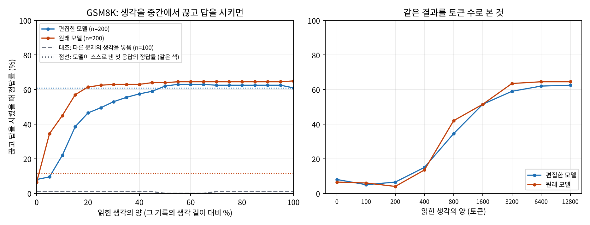
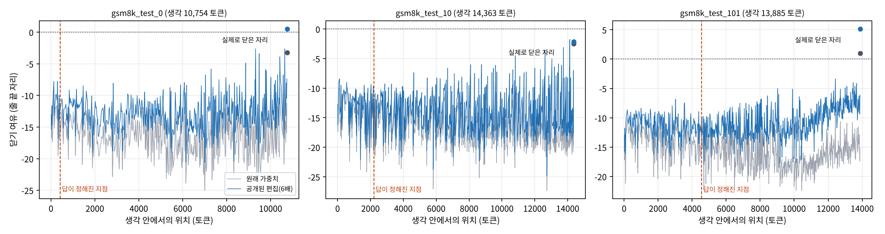
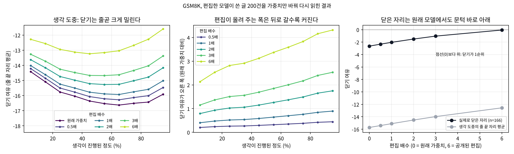
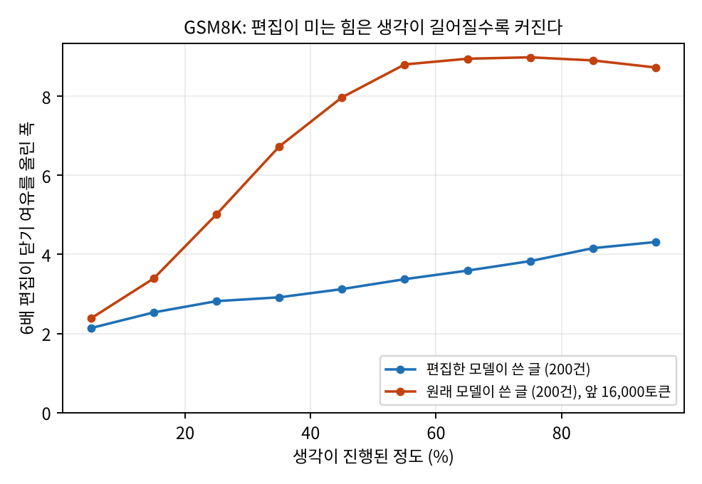

# 중간 결과: 생각의 어디까지가 답에 쓰이고, 닫는 결정은 어디서 나는가

2026-11-16 04:15 KST 기준. 모델은 Qwen3.5-0.8B, 문제는 GSM8K 시험 문제의 앞 200개다. MATH-500 앞 200문제의 결과는 뒤쪽에 따로 적었다.
숫자 전체는 `tables.md`, 그림은 이 폴더의 `fig*.png`, 기록별 원자료는 `raw/`에 있다.

## 요약

1. **답은 생각의 앞 15%에서 정해진다.** 편집한 모델의 생각은 중앙값이 9,242토큰인데, 답은 1,114토큰 지점에서 정해지고 그 뒤로 바뀌지 않는다. 생각의 85%는 답이 정해진 뒤에 쓴 것이다.
2. **원래 모델은 답을 몰라서 틀리는 것이 아니다.** 원래 모델이 스스로 낸 첫 응답은 11.5%만 맞는다. 그런데 같은 생각을 중간에서 끊고 답을 시키면 65.0%가 맞고, 이는 편집한 모델의 61.0%와 차이가 없다. 편집이 정답률을 올린 까닭은 푸는 능력이 아니라 생각을 닫는지에 있다.
3. **닫고 싶어 하는 정도는 답이 정해졌는지에 반응하지 않는다.** 모델이 생각을 닫는 토큰을 원하는 정도는 생각 내내 낮고, 답이 정해진 뒤에도 오르지 않는다.
4. **편집한 모델이 생각을 닫은 자리는 원래 가중치로 읽어도 가장 닫고 싶은 자리다.** 기록의 82.5%에서 그렇다. 다만 원래 가중치로는 문턱에 2.6이 모자라고, 편집은 그 자리를 2.6만큼 올려 문턱에 닿게 한다.
5. **그렇다고 편집이 "문턱을 2.6 낮춘 것"과 같지는 않다.** 편집이 닫는 쪽으로 미는 힘은 일정하지 않고 생각이 길어질수록 커진다(편집한 모델의 글에서 +2.1에서 +4.3으로, 원래 모델의 글에서는 +2.4에서 +8.8로). 가중치는 그대로 두고 닫는 토큰의 로짓에 2.5만 더해 생성하면 44문제 가운데 9문제만 닫는다. 아무것도 더하지 않았을 때(8문제)와 같다. 편집한 가중치는 같은 44문제 가운데 38문제를 닫는다.

MATH-500 앞 200문제에서도 다섯 결과가 모두 같은 방향으로 나온다.

후보 1의 말로 옮기면 이렇다. 치울 재고(답이 정해진 뒤의 생각)는 생각의 대부분을 차지할 만큼 크다. 지금 공개된 편집은 생각을 끝내게는 하지만 그 재고를 줄이지 못한다. 편집이 반응하는 것은 "답이 정해졌다"가 아니라 "생각이 길어졌다"에 가깝기 때문이다.

## 재료와 재는 방법

### 재료: 공개된 풀이 기록

MIT 연구진이 "Sparks of Weight-Space Programming"과 함께 공개한 기록을 썼다. 같은 문제 200개에 대해 두 모델이 낸 첫 응답의 전문이 들어 있다.

- **원래 모델**: Qwen3.5-0.8B 그대로다. 생각을 시작하면 좀처럼 끝내지 못한다. 200문제 가운데 21문제에서만 토큰 상한(32,768) 안에 생각을 닫았다.
- **편집한 모델**: 15번 층과 19번 층의 MLP 출력 가중치에서 열 64개씩을 한 방향으로 민 모델이다. 가중치의 나머지는 원래 모델과 같다. 민 크기를 이 글에서는 "배수"라고 부르고, 공개된 편집은 6배다. 이 모델은 200문제 가운데 188문제에서 생각을 닫았다.

Qwen3.5는 답을 내기 전에 생각을 쓰고, `</think>`라는 토큰 하나를 내서 생각을 닫은 다음 답을 쓴다. 아래에서 "생각을 닫는다"는 말은 이 토큰을 내는 것을 뜻한다.

### 측정 1: 생각을 끊고 답을 시키기 (실험 1)

기록에 있는 생각을 줄이 끝나는 자리 약 20곳에서 끊는다. 끊은 자리 뒤에 `</think>`와 "The final answer is \boxed{"를 붙여서, 모델이 거기까지의 생각만 가지고 답을 쓰게 한다. 이렇게 얻은 답을 "시킨 답"이라고 부른다. 끊는 자리는 앞쪽을 촘촘하게, 뒤쪽을 성기게 잡았다.

**답이 정해진 지점**은 시킨 답이 생각 끝에서 시킨 답과 같아지고, 그 뒤의 어느 자리에서도 다시 달라지지 않는 가장 이른 자리다. 정답인지와는 상관없이, 모델의 답이 더는 움직이지 않게 된 지점을 뜻한다.

이 측정이 믿을 만한지는 두 가지로 확인했다. 첫째, 생각 끝에서 시킨 답은 모델이 스스로 낸 답과 96.8% 같다(비교할 수 있는 158건). 둘째, 문제는 그대로 두고 생각만 다른 문제의 것으로 바꿔 넣으면(대조 실험, 100건) 정답률이 1%로 떨어지고, 시킨 답의 97%가 생각을 가져온 쪽 문제의 답과 같아진다. 시킨 답은 문제만 보고 찍은 것이 아니라 생각에 적힌 내용에서 나온다.

### 측정 2: 닫기 여유 (실험 4)

생각 안의 각 자리에서, 모델이 다음 토큰으로 `</think>`를 얼마나 원하는지를 잰다. **닫기 여유**는 `</think>`의 로짓에서 나머지 토큰 가운데 가장 큰 로짓을 뺀 값이다. 0보다 크면 `</think>`가 1순위이고, 음수이면 그만큼 밀려 있다는 뜻이다.

같은 글을 가중치만 바꿔 가며 다시 읽혀서 쟀다. 가중치는 원래 것, 그리고 편집을 0.5배, 1배, 2배, 3배, 6배(공개된 편집)로 넣은 것까지 여섯 가지다. 글이 같으므로 값의 차이는 가중치에서만 나온다.

## 결과 1. 답은 생각의 앞 15%에서 정해지고, 나머지는 답을 바꾸지 않는다

| | 편집한 모델 | 원래 모델 |
|---|---|---|
| 기록 수 | 200 | 200 |
| 생각 길이 중앙값 | 9,242토큰 | 32,768토큰(상한) |
| 답이 정해진 지점, 토큰 수 중앙값 | 1,114 | 773 |
| 답이 정해진 지점, 생각 길이 대비 중앙값 [95% 구간] | 15.4% [13.5, 18.8] | 7.0% [4.8, 7.0] |
| 답이 정해진 뒤에 쓴 생각의 비율(중앙값) | 84.6% | 93.0% |
| 같은 비율을 토큰 수로 합산 | 70.9% | 86.4% |

원래 모델의 비율은 생각의 앞 16,000토큰만 읽혀서 낸 값이다. 실제 생각은 대부분 32,768토큰까지 이어지므로 실제 비율은 이보다 더 치우쳐 있다.

끊는 자리가 20곳뿐이어서, 답이 정해진 지점은 "이 자리와 바로 앞 자리 사이"로만 안다. 표의 값은 그 가운데 늦은 쪽이다. 이른 쪽으로 잡으면 편집한 모델은 10.9%, 원래 모델은 4.7%가 된다. 어느 쪽으로 잡아도 결론은 같다.

생각의 뒤쪽이 답을 고치는 일은 드물다. 편집한 모델에서, 생각의 절반 지점에서 시킨 답이 틀렸다가 끝에서 맞게 된 문제는 200개 가운데 5개이고, 반대로 절반 지점에서 맞았다가 끝에서 틀리게 된 문제가 7개다. 뒤쪽 절반은 고친 것보다 망친 것이 많다.

그림 1의 왼쪽은 생각을 몇 %까지 읽혔을 때 시킨 답이 맞는지를 보여 준다. 두 모델 모두 앞쪽에서 가파르게 오르고 곧 평평해진다. 오른쪽은 같은 결과를 토큰 수로 본 것이다.

## 결과 2. 원래 모델은 답을 몰라서 틀리는 것이 아니다

| | 편집한 모델 | 원래 모델 |
|---|---|---|
| 모델이 스스로 낸 첫 응답의 정답률 | 61.0% | 11.5% |
| 생각 끝에서 끊고 답을 시켰을 때 [95% 구간] | 61.0% [54.0, 67.5] | 65.0% [58.0, 71.5] |
| 생각을 3,200토큰까지만 읽히고 시켰을 때 | 59.0% | 63.5% |
| 생각을 1,600토큰까지만 읽히고 시켰을 때 | 51.5% | 51.5% |
| 생각 없이 바로 시켰을 때 | 8.0% | 6.5% |
| 대조: 다른 문제의 생각을 넣고 시켰을 때(100건) | 1.0% | - |

원래 모델이 스스로 낸 응답의 정답률은 11.5%다. 생각을 닫지 못해 답을 아예 쓰지 못한 문제가 대부분이기 때문이다. 그런데 같은 생각을 끊고 답을 시키면 65.0%가 맞는다. 편집한 모델의 61.0%와 구간이 겹친다.

이 결과는 MIT의 편집이 왜 정답률을 올렸는지를 설명한다. 편집은 모델이 문제를 더 잘 풀게 만든 것이 아니다. 원래 모델도 생각 안에 이미 같은 답을 적어 두었고, 편집은 그 생각을 닫고 답을 쓰게 했을 뿐이다.

토큰으로 보면 낭비의 크기가 드러난다. 원래 모델의 생각을 3,200토큰에서 끊고 답을 시키면 63.5%가 맞는다. 편집한 모델은 중앙값 9,242토큰을 쓰고 61.0%에 닿는다. 같은 정답률에 필요한 생각은 그 3분의 1이다.

## 결과 3. 닫고 싶어 하는 정도는 답이 정해졌는지에 반응하지 않는다

| 닫기 여유(줄 끝 자리 평균) | 원래 가중치 | 공개된 편집(6배) |
|---|---|---|
| 답이 정해지기 전 | -15.1 | -12.7 |
| 답이 정해진 뒤 | -15.7 | -12.4 |

편집한 모델이 쓴 글 200건을 두 가중치로 읽힌 값이다. 답이 정해진 뒤에 닫기 여유가 오른다면 모델이 "답이 나왔으니 닫자"고 판단한다고 볼 수 있다. 실제로는 오르지 않는다. 원래 가중치에서는 오히려 0.7 내려가고, 편집한 가중치에서도 0.3 오르는 데 그친다. 원래 모델이 쓴 글을 원래 가중치로 읽어도 마찬가지다(-15.1에서 -15.2). 생각 도중에 `</think>`가 1순위인 줄 끝 자리는 전체의 0.1%다.

그림 4는 기록 세 건의 닫기 여유를 처음부터 끝까지 그린 것이다. 빨간 점선이 답이 정해진 지점이다. 그 뒤로 수천 토큰 동안 닫기 여유는 -10에서 -20 사이에 머물고, 실제로 닫은 자리(오른쪽 끝의 점)에서만 0 근처로 뛰어오른다.

## 결과 4. 편집한 모델이 닫은 자리는 원래 가중치로 읽어도 가장 닫고 싶은 자리다

편집한 모델이 실제로 생각을 닫은 자리 166곳에서 잰 닫기 여유다(16,000토큰 안에서 닫은 기록).

| 편집 배수 | 0(원래) | 0.5 | 1 | 2 | 3 | 6(공개된 편집) |
|---|---|---|---|---|---|---|
| 닫은 자리의 닫기 여유(평균) | -2.64 | -2.33 | -2.04 | -1.51 | -1.03 | -0.06 |
| 원래 가중치 대비 오른 폭 | 0 | +0.31 | +0.60 | +1.13 | +1.61 | +2.58 |
| 생각 도중 줄 끝 자리의 닫기 여유(평균) | -15.72 | -15.42 | -15.11 | -14.53 | -13.98 | -12.57 |
| 닫은 자리가 그 앞 모든 자리보다 높은 기록의 비율 | 82.5% | 84.3% | 84.9% | 86.1% | 88.0% | 89.2% |

읽는 법은 이렇다. 편집한 모델이 닫은 자리를 원래 가중치로 다시 읽으면, 그 자리의 닫기 여유는 -2.64다. 생각 도중의 평균(-15.72)보다 13이 높고, 기록의 82.5%에서는 그 자리가 생각 전체를 통틀어 닫기 여유가 가장 높은 자리다. 같은 글을 읽는다면 원래 가중치도 "닫는다면 여기"라는 자리를 똑같이 짚는다. 그 자리에서 모자란 것은 문턱까지의 2.6이다.

편집은 이 자리를 배수에 거의 비례해서 올린다(1배에 +0.60, 6배에 +2.58). 6배에서 닫기 여유가 0에 닿고, 그래서 모델이 닫는다. MIT가 보고한 "배수를 키울수록 정답률이 오른다"는 결과가 이 표의 첫 줄과 같은 모양이다.

편집한 모델이 쓴 글은 원래 가중치로 읽어도 똑같이 그럴듯하다. 토큰당 NLL이 원래 가중치에서 0.439, 편집한 가중치에서 0.439다. 닫는 자리를 빼면 원래 가중치도 쓸 수 있었던 글이라는 뜻이다.

그림 3의 왼쪽은 생각 도중의 닫기 여유, 가운데는 편집이 올려 준 폭, 오른쪽은 실제로 닫은 자리의 닫기 여유를 편집 배수별로 그린 것이다.

## 결과 5. 편집은 문턱을 일정하게 낮추는 것이 아니다. 미는 힘이 생각이 길어질수록 커진다

결과 4만 보면 "편집 = 닫는 문턱을 2.6 낮춘 것"이라고 읽기 쉽다. 두 가지 결과가 그렇지 않다고 말한다.

**첫째, 편집이 닫기 여유를 올려 주는 폭이 자리마다 다르다.** 6배 편집이 줄 끝 자리의 닫기 여유를 올린 폭이다.

| 읽힌 글 | 생각의 첫 10% | 중간(50~60%) | 마지막 10% | 답이 정해지기 전 | 답이 정해진 뒤 |
|---|---|---|---|---|---|
| 편집한 모델이 쓴 글(200건) | +2.1 | +3.4 | +4.3 | +2.4 | +3.3 |
| 원래 모델이 쓴 글(200건, 앞 16,000토큰) | +2.4 | +8.8 | +8.7 | +2.6 | +7.0 |

편집한 모델의 글에서는 미는 힘이 처음부터 끝까지 두 배로 커진다. 원래 모델의 글, 곧 닫지 못하고 길게 이어진 글에서는 훨씬 가파르다. 앞 1,600토큰에서는 +2.4이던 것이 8,000토큰을 넘기면 +8.8 안팎에서 머문다. 편집은 모든 자리에 같은 값을 더하지 않는다. 생각이 길게 이어진 상태일수록 더 세게 닫는 쪽으로 민다.

원래 모델의 글은 토큰당 NLL이 0.17로, 편집한 모델의 글(0.44)보다 훨씬 예측하기 쉽다. 같은 내용을 되풀이하는 글에서 흔한 모습이다. 이 글을 편집한 가중치로 읽으면 NLL이 0.23로 오른다. 편집한 모델은 이런 글을 덜 쓴다는 뜻이다. 편집이 반응하는 것이 "길이"인지 "되풀이"인지는 아직 가르지 못했다.

**둘째, 로짓에 일정한 값만 더해서는 편집한 모델처럼 닫지 못한다(실험 4b).** 가중치는 원래대로 두고, 생성할 때 `</think>`의 로짓에 2.5만 더했다. 2.5는 결과 4에서 편집이 닫은 자리를 올려 준 폭이다. 같은 생성 코드로 편집한 모델도 돌려서 나란히 놓았다. 문제는 GSM8K 앞쪽의 44문제이고, 생각은 16,000토큰에서 끊었다.

| 조건 (같은 44문제) | 16,000토큰 안에 닫은 문제 | 정답 | 닫은 문제의 생각 길이 중앙값 |
|---|---|---|---|
| 원래 가중치 + 로짓 2.5 | 9 | 9 | 2,973토큰 |
| 원래 가중치, 더한 값 없음(공개 기록) | 8 | 9 | - |
| 편집한 가중치(6배), 더한 값 없음 | 38 | 28 | 6,604토큰 |
| 편집한 가중치(6배), 더한 값 없음(공개 기록) | 41 | 29 | - |

2.5를 더한 쪽은 44문제 가운데 9문제를 닫았다. 아무것도 더하지 않은 원래 모델의 공개 기록에서 같은 44문제 가운데 닫은 것이 8문제다. 2.5를 더한 효과가 보이지 않는다. 편집한 가중치는 38문제를 닫았고 28문제를 맞혔다. 공개 기록의 41문제, 29문제와 가까우므로 이 생성 코드는 공개 기록을 재현한다. 더한 값이 생성에 실제로 들어가는지도 따로 확인했다(100을 더하면 첫 토큰이 `</think>`가 된다).

효과가 없는 까닭은 결과 3에서 짐작할 수 있다. 생각 도중에는 닫기 여유가 -15 안팎이어서 2.5를 더해도 `</think>`가 뽑힐 후보에 들지 못한다. 2.5가 의미를 가지려면 글이 먼저 닫기 여유가 -2.6쯤 되는 자리에 이르러야 하는데, 원래 모델이 혼자 쓴 글에서는 닫기 여유의 최고값이 평균 -7.1에 그친다. 닫지 못한 글의 끝을 열어 보면 같은 문장을 조금씩 바꿔 가며 되풀이하고 있다.

두 결과를 합치면, 편집의 효과는 "닫는 자리의 문턱을 2.6 낮춘다"로 설명되지 않는다. 편집은 생각이 길어질수록 닫는 쪽으로 더 세게 밀고, 그 결과 글이 닫을 만한 자리에 이르게 된다. 문턱을 넘기는 것은 그다음 일이다.

## MATH-500에서도 같은 모양이 나온다

같은 실험을 MATH-500 앞 200문제에서 되풀이했다. 다섯 결과가 모두 같은 방향이다.

| | 편집한 모델 | 원래 모델 |
|---|---|---|
| 답이 정해진 지점, 생각 길이 대비 중앙값 | 22.4% | 10.8% |
| 모델이 스스로 낸 첫 응답의 정답률 | 46.0% | 7.5% |
| 생각 끝에서 끊고 답을 시켰을 때 [95% 구간] | 57.0% [50.0, 63.5] | 50.5% [43.5, 57.0] |
| 닫기 여유, 답이 정해지기 전 → 뒤 (자기 가중치로 자기 글을 읽음) | -13.5 → -13.5 | -15.0 → -15.1 |
| 6배 편집이 닫기 여유를 올린 폭, 첫 10% → 마지막 10% | +1.4 → +3.1 | +1.6 → +9.0 |

편집한 모델이 닫은 자리(16,000토큰 안에서 닫은 76건)의 닫기 여유는 원래 가중치로 -2.70이고, 73.7%의 기록에서 그 앞 모든 자리보다 높다. 6배 편집은 이 자리를 +2.29 올린다. GSM8K의 -2.64, 82.5%, +2.58과 거의 같다.

GSM8K와 다른 점이 하나 있다. 편집한 모델이 스스로 낸 답의 정답률(46.0%)이 끝에서 시킨 답의 정답률(57.0%)보다 낮다. MATH-500에서는 편집한 모델도 200문제 가운데 48문제에서 생각을 닫지 못하기 때문이다.

## 이 결과가 후보 1에 뜻하는 것

- **재고는 있고, 크다.** 답이 정해진 뒤에 쓴 생각이 편집한 모델에서 85%, 원래 모델에서 93%다. 후보 1이 "재고"라고 부른 것이 실제로 생각의 대부분을 차지한다.
- **지금 공개된 편집은 재고를 치우지 못한다.** 편집한 모델도 답이 정해진 뒤에 중앙값으로 6,170토큰을 더 쓴다. 편집이 미는 힘은 생각이 길어져야 커지고(결과 5), 답이 정해졌는지에는 묶여 있지 않다(결과 3). 그래서 생각이 끝나기는 하지만 일찍 끝나지는 않는다.
- **치우기의 목표가 구체적으로 정해진다.** 닫기 여유가 "생각이 길어졌을 때"가 아니라 "답이 정해졌을 때" 오르게 만드는 편집을 찾으면 된다. 닫을 자리의 모양은 원래 가중치도 이미 알아본다(결과 4). 새로 넣어야 할 것은 닫을 때를 답에 맞추는 일이다.
- **잴 대상도 정해진다.** 다음 실험(부품별 기여)은 답이 정해진 지점의 앞과 뒤에서 어떤 부품이 일하는지를 가른다. 이번 결과가 그 실험의 채점 기준(답이 정해진 지점)을 준다.

## 한계

- 모델 하나(Qwen3.5-0.8B)의 결과다. 벤치마크는 GSM8K와 MATH-500의 앞 200문제씩이다.
- 생각은 앞 16,000토큰까지만 읽혔다. 원래 모델의 기록 대부분과 편집한 모델의 기록 일부가 여기서 잘린다.
- "답이 정해졌다"는 "끊고 시킨 답이 더는 바뀌지 않는다"로 정의한 것이다. 모델 내부에서 답이 언제 계산되는지를 직접 본 것은 아니다. 이를 직접 보는 것이 다음 실험이다.
- 닫기 여유는 이미 쓰인 글을 다시 읽혀서 잰 값이다. 실제 생성에서는 샘플링(temperature 0.6)과 반복 벌점(presence penalty 1.5)이 더해지므로, 닫기 여유가 0보다 조금 낮아도 `</think>`가 뽑힐 수 있다.
- 실험 4b(로짓에 일정한 값 더하기)는 44문제이고, 더한 값은 2.5 하나만 봤다. 값을 더 키우면 닫는지, 닫더라도 생각 길이와 정답률이 편집한 모델과 같은지는 아직 모른다.
- 결과 4는 편집한 모델이 쓴 글을 다시 읽혀서 얻은 것이다. 편집이 글을 닫을 만한 자리까지 어떻게 끌고 가는지, 곧 어느 토큰에서 원래 모델과 다른 선택을 하는지는 아직 재지 못했다.
